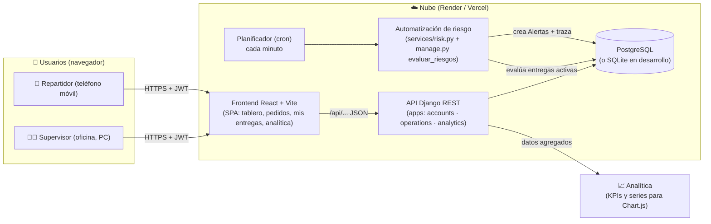

# Entregable 2a · Arquitectura de la solución

## Diagrama de arquitectura

## Componentes y responsabilidades

| Componente | Responsabilidad |
|---|---|
| `frontend` (React + Vite) | Interfaces por rol, formularios con validación, consumo de la API, gráficas Chart.js |
| `backend/apps/accounts` | Usuarios, roles, repartidores, autenticación JWT y permisos |
| `backend/apps/operations` | Reglas del negocio: pedidos, entregas, incidencias, alertas y trazabilidad |
| `backend/apps/operations/services/risk.py` | **Regla de automatización** de clasificación de riesgo |
| `backend/apps/analytics` | Consultas agregadas (KPIs, series, comparativas) para la analítica |
| Base de datos | Persistencia única; SQLite en desarrollo, PostgreSQL en nube |
| Planificador | Ejecuta `manage.py evaluar_riesgos` cada minuto (en la demo, el tablero lo dispara al consultar) |

## Controles de seguridad

- Autenticación JWT (access 8 h / refresh 1 día) en todos los endpoints.
- Autorización por rol: solo administrador crea pedidos, asigna, resuelve
  incidencias, consulta analítica, historial y alertas.
- Un repartidor solo puede listar/actualizar **sus** entregas (filtro en el
  queryset; cualquier otro objeto devuelve 404).
- Contraseñas cifradas; sin secretos en el repositorio (`.env.example` como
  plantilla); CORS restringido en producción.

## Estrategia de operación sin conexión / servicio caído

- Si el teléfono del repartidor pierde señal, la acción falla con el mensaje
  *"No hay conexión con el servidor…"* y la operación puede reintentarse al
  reconectar (los estados no se pierden: la API valida transiciones
  idempotentes y rechaza las inválidas con un error claro).
- Si la API cae, el frontend muestra el error sin perder la sesión
  (renovación de token automática y reintento).
- El proceso manual (WhatsApp) queda como respaldo documentado mientras se
  recupera el servicio — mismo esquema que el negocio ya conoce.
