# Entregable 2c · Casos de uso

Actores: **Administrador** (supervisor de despacho) y **Repartidor**.

```mermaid
flowchart TB
    Admin["👨‍💼 Administrador"]
    Rep["🛵 Repartidor"]

    subgraph Sistema["DeliverTrack"]
        CU1["CU-01 Iniciar sesión"]
        CU2["CU-02 Registrar pedido"]
        CU3["CU-03 Preparar pedido"]
        CU4["CU-04 Asignar entrega"]
        CU5["CU-05 Consultar tablero"]
        CU6["CU-06 Atender alertas"]
        CU7["CU-07 Resolver incidencia"]
        CU8["CU-08 Consultar analítica"]
        CU9["CU-09 Consultar historial"]
        CU10["CU-10 Ver mis entregas"]
        CU11["CU-11 Registrar salida"]
        CU12["CU-12 Marcar entrega realizada"]
        CU13["CU-13 Reportar incidencia"]
    end

    Admin --> CU1 & CU2 & CU3 & CU4 & CU5 & CU6 & CU7 & CU8 & CU9
    Rep --> CU1 & CU10 & CU11 & CU12 & CU13
```

## Descripción de los casos de uso principales

| ID | Caso de uso | Actor | Flujo principal | Validaciones / errores |
|---|---|---|---|---|
| CU-01 | Iniciar sesión | Ambos | Credenciales → JWT → redirección según rol | Credenciales inválidas → mensaje claro |
| CU-02 | Registrar pedido | Admin | Formulario cliente/dirección/hora límite → `RECIBIDO` | Hora límite pasada, campos vacíos → error comprensible |
| CU-03 | Preparar pedido | Admin | `RECIBIDO → PREPARANDO` | Solo desde RECIBIDO; repetido → error |
| CU-04 | Asignar entrega | Admin | Elige repartidor → crea `Entrega`, pedido `ASIGNADO` | Pedido ya asignado, repartidor inexistente/inactivo → error |
| CU-05 | Consultar tablero | Admin | Contadores + entregas activas con semáforo | — |
| CU-06 | Atender alertas | Admin | Marca alerta como atendida; la entrega sigue visible | — |
| CU-07 | Resolver incidencia | Admin | `INCIDENCIA → EN_CAMINO`; queda registrada resuelta | Sin incidencia activa → error |
| CU-08 | Consultar analítica | Admin | KPIs y 4 gráficas para decidir (asignación de carga, refuerzos) | — |
| CU-09 | Consultar historial | Admin | Trazabilidad con filtros por entidad | — |
| CU-10 | Ver mis entregas | Repartidor | Lista solo sus entregas con dirección y hora límite | Solo ve las suyas (las ajenas → 404) |
| CU-11 | Registrar salida | Repartidor | `ASIGNADO → EN_CAMINO` con hora de salida | Solo desde ASIGNADO |
| CU-12 | Marcar entregada | Repartidor | `EN_CAMINO → ENTREGADO` con hora de entrega; pedido `ENTREGADO` | Solo desde EN_CAMINO/INCIDENCIA atendida |
| CU-13 | Reportar incidencia | Repartidor | Tipo + descripción → `INCIDENCIA` | Descripción vacía o tipo inválido → error |
