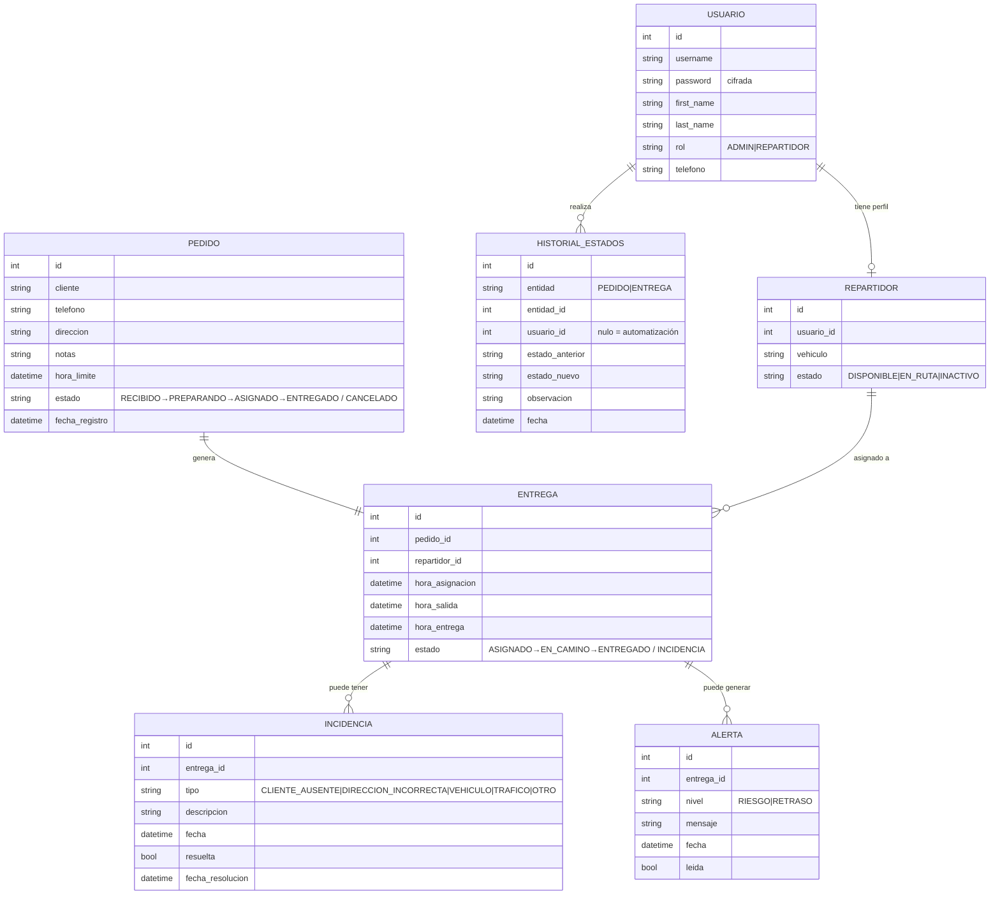

# Entregable 2d · Modelo de datos

## Diagrama entidad-relación

## Reglas de negocio asociadas

1. Un pedido genera **a lo sumo una entrega** (1:1); la entrega se crea al asignar.
2. Transiciones válidas de pedido: `RECIBIDO→PREPARANDO`, `RECIBIDO/PREPARANDO→ASIGNADO`
   (al asignar), `*→ENTREGADO` (al entregarse su entrega), `*→CANCELADO`
   (salvo ya entregado o con entrega en ruta).
3. Transiciones válidas de entrega: `ASIGNADO→EN_CAMINO` (salida),
   `EN_CAMINO→ENTREGADO`, `ASIGNADO/EN_CAMINO→INCIDENCIA` (reporte),
   `INCIDENCIA→EN_CAMINO` (resolución por el administrador).
4. Toda transición escribe en `HISTORIAL_ESTADOS` (usuario, fecha, acción, resultado).
5. La automatización no duplica alertas: existe a lo sumo una alerta **activa**
   por entrega y nivel.
6. La hora límite debe ser futura al registrar el pedido (validación de entrada).
7. El tiempo de entrega se calcula como `hora_entrega − (hora_salida o hora_asignacion)`;
   una entrega es "a tiempo" si `hora_entrega ≤ hora_limite`.
